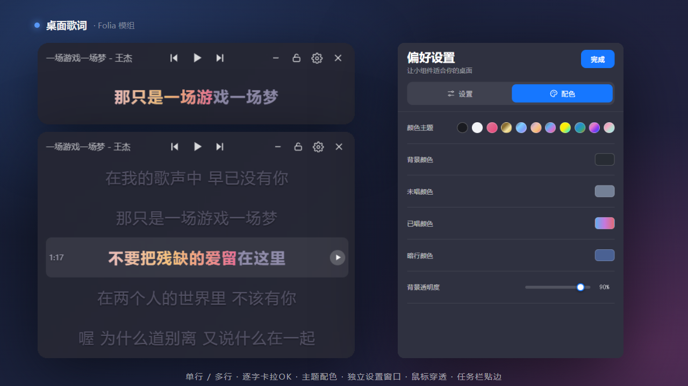

# 桌面歌词 (folia-desktop-lyric)

Folia 桌面歌词模组：在桌面上常驻一条胶囊歌词，可单行 / 多行、逐字卡拉 OK、翻译与音译，可拖动、缩放、锁定穿透、一键贴任务栏，并提供独立的设置窗口与配色面板。

## 功能

* **胶囊歌词条**：桌面最上层显示当前歌词，圆角半透明胶囊；顶栏左侧歌名、中间播放控制、右侧是「穿透锁 · 设置齿轮 · 关闭」。
* **单行 / 多行**：窗口拉高到阈值后自动切成多行歌词板，可上下滚动并自动跟随当前句；最后一句也能滚到中间。
* **逐字卡拉 OK**：有逐字数据时按已唱/未唱渐变擦除。
* **翻译 / 音译**：可在设置里单独开关翻译行、音译行。
* **可拖动 / 四边缩放**：解锁时按住拖动；拖四边 / 四角调整尺寸（缩放用 rAF 合并，跟手不卡）。
* **鼠标穿透（锁定）**：点顶栏锁形按钮切换穿透，点击落到下层程序；锁定时鼠标停在歌词上会临时解冻以便拖动 / 解锁。
* **一键贴任务栏**：吸附到任务栏那条并保持置顶；再拖出即可恢复原尺寸。
* **独立设置窗口**：点齿轮弹出独立窗口，含「设置 / 配色」两个标签，改动实时生效。
  * 设置：歌词字体（分页 + 搜索选择）、歌词偏移与字号（`[−][值][+]` 步进，中间数值可手动输入）、翻译 / 音译开关。
  * 配色：主题预设（内置多套 + `themes.json` 可自定义）、背景 / 未唱 / 已唱 / 暗行颜色、背景透明度。
* **记住状态**：位置、尺寸、字体、字号、颜色/主题、偏移、翻译/音译显隐、锁定状态都会保存，下次启动沿用。

## 快捷键

在「设置 → 模组 → 展开桌面歌词」里，最上面是「显示桌面歌词」开关；全局快捷键默认关闭，可在同一面板开启并自定义组合键。

|默认快捷键|作用|
|-|-|
|`Ctrl+Shift+L`|开启 / 关闭穿透|
|`Ctrl+Shift+H`|显示 / 隐藏桌面歌词|

## 上手

装好后播放音乐，桌面自动出现胶囊歌词。常用操作：

|想做的事|怎么做|
|-|-|
|上 / 下一首、播放暂停|点胶囊顶栏的 `⏮` `⏸` `⏭`|
|挪动位置|解锁时按住歌词拖动|
|开 / 关穿透|点顶栏锁形按钮（齿轮左侧）|
|贴到任务栏 / 拖出|点顶栏左侧的「移到任务栏」按钮；再拖动即退出|
|改字体 / 字号 / 偏移 / 翻译音译 / 颜色|点齿轮打开设置窗口|
|改字号|解锁时在歌词上滚滚轮，或在设置里用步进 / 手动输入|

位置、字体、字号、颜色、锁定状态、歌词偏移、翻译/音译显隐都会自动保存。

## 安装

- **模组市场**（推荐）：Folia「设置 → 模组 → 模组市场」搜索「桌面歌词」安装。
- **拖 zip**：把打包的 zip 直接拖进「设置 → 模组」面板，按提示确认权限。
- **手动**：把 `folia-desktop-lyric/` 整个目录放进 `%APPDATA%\Folia\mods\folia-desktop-lyric\`，重启 Folia。

## 权限说明

|权限|用途|
|-|-|
|`playback.read`|读取当前歌曲与歌词进度，用来显示歌词|
|`playback.control`|上一首 / 下一首 / 播放暂停 / 进度跳转|
|`filesystem.data`|在模组自己的数据目录保存位置、字号、颜色、锁定状态等|

模组不上传任何数据，不下载执行远程代码，只在模组自己的数据目录里保存配置。

> 需要 Folia 0.7.21 及以上版本。

## 技术说明

* `main.cjs`：主进程。创建无边框透明置顶窗口；轮询 Folia 播放状态挑出当前歌词（含翻译 / 音译）推给渲染层；处理锁定（`setIgnoreMouseEvents`）、拖动、四边缩放、按内容贴合窗口、任务栏模式与独立的设置窗口。
* `client.mjs`：Folia 渲染层入口。执行歌词窗口排队的切歌 / 播放控制命令；注册设置面板项与播放器进度条上的锁形按钮。
* `lyrics.cjs`：按 `startTime` 建索引二分查找当前行，空档返回空串不显示占位。
* `fonts.cjs`：解析本机字体 sfnt `name` 表列出字体族，按文件数指纹缓存 7 天，供字体选择器用。
* `lyric.html` / `settings.html` / `preload.cjs`：歌词窗口与设置窗口的界面、IPC 桥。
* `color-picker.js`：可复用取色器组件（单色 / 渐变）；`themes.json`：内置主题配色；`hotkeys.cjs`：快捷键。

## 许可证

MIT
